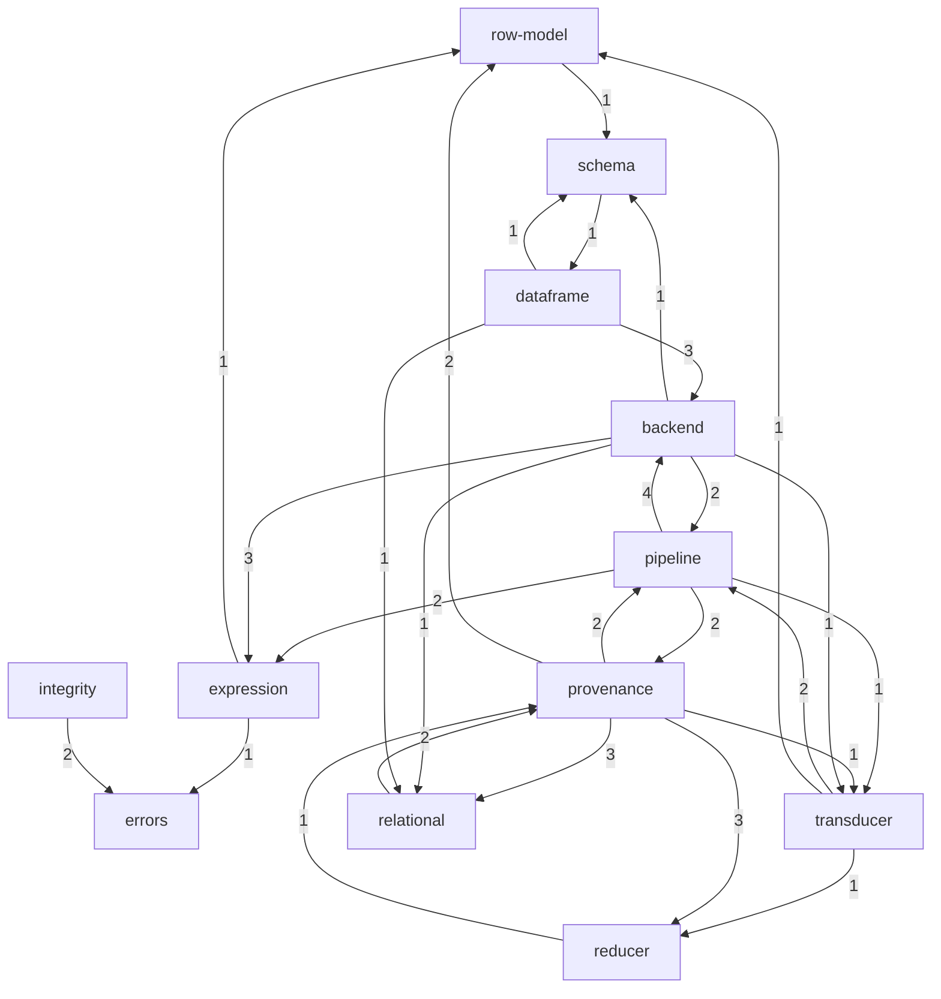

# OpenSpec Topology — poco

## Cartography — spec-space macro map (union target state)
**Entry zoom level:** macro
**Scope covered:** `openspec/changes/{add-core-architecture,add-advanced-data-integrity,fix-core-architecture-spec-errors,add-backend-adapter-protocol,add-provenance-tracking}/`, cross-checked against `openspec/project.md`

**Unit of mapping:** a *capability* (`specs/<name>/spec.md`). No baseline is
archived yet, so the map renders the **union target state**: all five pending
changes applied. Counts are requirement/scenario/line counts re-verified
against the files immediately before this report was written.

The poco package itself is 15 lines of stubs (`poco/po.py`) — the specs are
the architecture; `po.py` and `tests/test_import.py` are placeholders.

## Capability inventory

| Capability | Path (target state) | Responsibility (from evidence) | Weight | Deps out → | Fan-in |
| :--- | :--- | :--- | :--- | :--- | :--- |
| dataframe | `…/add-core-architecture/specs/dataframe/` + 2 deltas | Immutable lazy value object; materialization; export; `explain()` | ▓▓░░░░░░░░ 17% | backend, relational, schema | 1 |
| pipeline | `…/add-core-architecture/specs/pipeline/` + 2 deltas | `PipelineStep` = `DataOp`+`SchemaTransform`+`ProvenanceTransform`; validated factories; `\|` composition | ▓▓░░░░░░░░ 17% | backend, expression, provenance, transducer | 6 |
| expression | `…/add-core-architecture/specs/expression/` + fix delta | Deferred `Expr` tree; type inference; null-handling; guardrails | ▓░░░░░░░░░ 12% | errors, row-model | 5 |
| relational | `…/add-core-architecture/specs/relational/` + 2 deltas | Joins, `groupby`, relational operators on `PipelineStep`s | ▓░░░░░░░░░ 11% | provenance | 5 |
| provenance | `…/add-provenance-tracking/specs/provenance/` (new) | `RowId`, `ProvenanceTransform` hierarchy, `Selection` algebra, `Fibers` | ▓░░░░░░░░░ 11% | pipeline, reducer, relational, row-model, transducer | 5 |
| schema | `…/add-core-architecture/specs/schema/` | Schema declaration, inference, evolution; supported column types | ▓░░░░░░░░░ 7% | dataframe | 3 |
| transducer | `…/add-core-architecture/specs/transducer/` + 2 deltas | Stateful streaming transforms; `distinct` (+ttl/max_seen) | ▓░░░░░░░░░ 5% | pipeline, reducer, row-model | 3 |
| errors | `…/add-core-architecture/specs/errors/` + fix delta | `PocoError` taxonomy; boundary translation; pass-through vs guardrail | ▓░░░░░░░░░ 5% | — | 3 |
| reducer | `…/add-core-architecture/specs/reducer/` + 2 deltas | Three-phase reducer protocol (+optional `unstep`); built-ins; determinism law | ▓░░░░░░░░░ 5% | provenance | 4 |
| backend | `…/add-backend-adapter-protocol/specs/backend/` (new) | `Backend` protocol; `LogicalOp` execution; `NullPolicy`; import/export boundary | ▓░░░░░░░░░ 4% | expression, pipeline, relational, schema, transducer | 7 |
| integrity | `…/add-advanced-data-integrity/specs/integrity/` (new) | Gap detection, monotonicity, stable sort, multiplicity constraints | ▓░░░░░░░░░ 4% | errors | 0* |
| aggregation | `…/add-core-architecture/specs/aggregation/` | Column-bound reducers (`sum_of`, `mean_of`, …) | ▓░░░░░░░░░ 2% | — | 0 |
| row-model | `…/add-core-architecture/specs/row-model/` | The row contract: a row is exactly the declared schema's columns | ▓░░░░░░░░░ 1% | schema | 4 |

\* integrity's `IntegrityError` contracts are consumed via `errors` and via
runtime semantics, not by explicit `integrity/spec.md` citations — see
observations.

**Total normative spec text: 3,999 lines / 128 requirements / 386 scenarios.**
Weights are target-state normative lines (base spec + ADDED delta lines;
MODIFIED deltas replace text ~1:1 and are not double-counted).

## Dependency matrix

Tier assignment is **inferred** from majority dependency direction (no
declared layering doc exists): T0 = row-model, schema · T1 = expression,
transducer, reducer, aggregation, errors · T2 = pipeline, relational,
integrity, provenance, backend · T3 = dataframe. `↑` = edge pointing to a
same-or-lower tier than expected (a "reference cycle" edge in spec space).

|  | row-model | schema | expression | transducer | reducer | aggregation | errors | pipeline | relational | integrity | provenance | backend | dataframe |
| :--- | :--- | :--- | :--- | :--- | :--- | :--- | :--- | :--- | :--- | :--- | :--- | :--- | :--- |
| row-model | — | | | | | | | | | | | | |
| schema | | — | | | | | | | | | | | ↑1 |
| expression | 1 | | — | | | | 1 | | | | | | |
| transducer | 1 | | | — | 1 | | | ↑2 | | | | | |
| reducer | | | | | — | | | | | | ↑1 | | |
| aggregation | | | | | | — | | | | | | | |
| errors | | | | | | | — | | | | | | |
| pipeline | | | 2 | 1 | | | | — | | | 2 | 4 | |
| relational | | | | | | | | | — | | 2 | | |
| integrity | | | | | | | 2 | | | — | | | |
| provenance | 2 | | | 1 | 3 | | | 2 | 3 | | — | | |
| backend | | 1 | 3 | 1 | | | | 2 | 1 | | | — | |
| dataframe | | 1 | | | | | | | 1 | | | 3 | — |

Rows depend on columns. (Row-model's own edge to schema is intra-T0.)

## Capability graph

## Composition

| Kind | Files | Lines | Notes |
| :--- | :--- | :--- | :--- |
| Normative specs | 25 | 3,999 | 10 base capabilities + 15 delta files across 4 delta changes |
| Planning prose | 15 | ~1,700 | `proposal.md`, `design.md`, `tasks.md` × 5 changes |
| Code | 2 | 15 | `poco/po.py` (12), `poco/__init__.py` (3) — stubs |
| Tests | 1 | ~10 | `tests/test_import.py` — import smoke test |

The repository is ~99.6% specification by volume: the spec corpus is the
product under construction.

## Structural observations

- **Reference cycles (3), all created by pending-change deltas:** pipeline ↔
  backend (4+2 edges — the `LogicalOp` reification is specified in both
  directions); provenance ↔ relational (3+2 — `Fibers`/`.aggregate` vs
  `groupby` referencing `provenance/spec.md`); provenance ↔ reducer (3+1 —
  `unstep`/invertibility vs fiber recomputation). In spec space these are
  normative cross-bindings, not import cycles; each pair was introduced
  deliberately by two changes that co-specify one contract.
- **Layer-skipping edges (↑ in matrix):** `schema → dataframe` (T0 → T3),
  `transducer → pipeline` (T1 → T2), `reducer → provenance` (T1 → T2).
  Each is a single citation where a lower-tier spec names an upper-tier
  contract.
- **Hub (fan-out):** `provenance` — 11 outgoing reference edges, the most
  interconnected capability. **Hub (fan-in):** `backend` — 7 incoming, but
  6 of those come from the backend change's own delta files; the only
  incoming edge from a *different* change family is pipeline → backend (4).
- **Orphan:** `aggregation` has zero explicit reference edges in either
  direction. Its API (`po.sum_of`, `po.mean_of`, …) is used throughout
  `relational` and `provenance` scenarios but is never cited by
  `aggregation/spec.md` path — the dependency is implicit in API naming.
- **Bulk:** `dataframe` + `pipeline` hold 34% of all normative text
  (1,363 of 3,999 lines) and 35% of all scenarios (134 of 386).
- **Change ownership:** 4 of 13 capabilities are new in pending changes
  (backend, integrity, provenance, + aggregation is core); 8 of 13 are
  modified by at least one delta. No capability is untouched by the delta
  set except row-model, schema, and aggregation.

## Key Relationships

- `pipeline → backend` (4 citations, strongest single edge): the `LogicalOp`
  reification lives in pipeline's factory requirement but is executed per
  backend's protocol — the spine of the adapter design.
- `provenance → reducer` (3): `unstep`/invertibility exists *because*
  selection shrinkage needs cheap re-reduction — the interactive-visualization
  motivation reaches all the way into the reducer protocol.
- `dataframe → backend` (3): construction-time `backend=`/`on_unsupported=`
  wiring makes dataframe the composition root of the target state.
- `relational ↔ provenance` (2+3): `groupby` is simultaneously a relational
  operator and a `Fibration` producer — the two capabilities co-own it.
- `expression → errors` (1): the `InvalidExprUsageError` guardrail makes
  every expression-usage rule a member of the public taxonomy.

## Open Questions

- Is the `aggregation` orphan status intentional (its scenarios self-cite
  via `po.reduce`) or a missing cross-reference from `relational`/`provenance`?
- The three reference cycles: acceptable as co-specified contracts, or
  should each be broken pre-archival (e.g., by moving `LogicalOp` into
  pipeline only and having backend import it, not vice versa)?
- `schema → dataframe` cites dataframe for construction-time schema
  validation — does schema evolution need that citation post-archival, or
  should the rule live in dataframe?

## Adjacent levels offered

- **meso:** `provenance` — the densest capability (10 requirements, 11 outgoing
  edges); its `Fibers`/`Selection` wiring deserves a district map.
- **meso:** `pipeline` — largest scenario count (66); factory/`DataOp`/
  `SchemaTransform`/`ProvenanceTransform` quadrants.
- **micro:** trace "life of a `Selection`" — `df.select_rows(pred)` →
  materialization → `pull_back` through composed `ProvenanceTransform` →
  `restrict`, with file:line at every hop.
