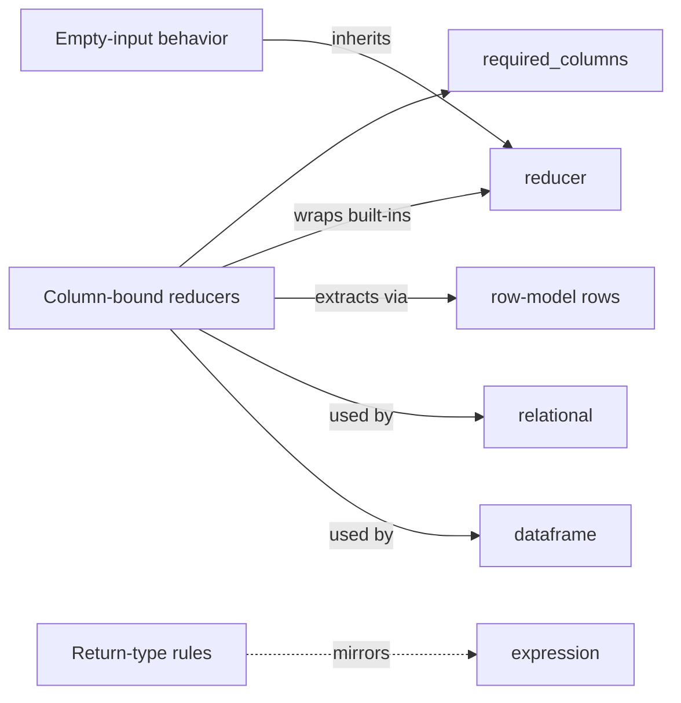

# Meso — `aggregation` capability

## Cartography — aggregation (spec district)
**Entry zoom level:** meso (parent: macro map, T1 tier)
**Scope covered:** `openspec/changes/add-core-architecture/specs/aggregation/spec.md`
**Size:** 5 requirements · 8 scenarios · 85 lines · defined by `add-core-architecture`; never modified by any delta

## Parent context

The smallest computational capability: column-bound reducer factories
wrapping the plain reducers from `reducer` with expression extraction.
Explicitly zero reference edges in or out (the corpus' only orphan — see
observations).

## Component table

| Component | Path | Role | External ports |
| :--- | :--- | :--- | :--- |
| Column-bound reducers | `aggregation/spec.md:3` | `sum_of/mean_of/min_of/max_of/count_of(expr)` = base reducer + column extraction | wraps `reducer` built-ins; consumes `row-model` rows |
| Aggregations expose required_columns | `aggregation/spec.md` (req 2) | Bound expression's columns exposed as `required_columns` | mirrors `expression`'s `required_columns` req |
| Compatible with relational operations | `aggregation/spec.md` (req 3) | Usable by `groupby` and `DataFrame` reduce without redefining laws | consumed by `relational` groupby, `dataframe` reduce |
| Empty-input follows wrapped reducer | `aggregation/spec.md` (req 4) | total/partial semantics inherited from inner reducer | delegates to `reducer` empty-input req |
| sum_of return type matches column type | `aggregation/spec.md` (req 5) | Type-preservation table (int→int, float→float, bool→int, mean→float) | mirrors `expression` type-inference table |

## Wiring graph

## Structural observations

- **Orphan capability:** no spec file cites `aggregation/spec.md`, yet its
  factories appear in `relational`/`provenance`/`dataframe` scenarios
  (`po.sum_of` etc.). The dependency exists only in API naming — flagged in
  macro open questions as the top spec-hygiene gap.
- Duplicates responsibility boundaries deliberately: reqs 2/4/5 each pin
  aggregation to an *existing* rule in another capability rather than
  restating it (mirroring, not restating — keeps single source of truth).
