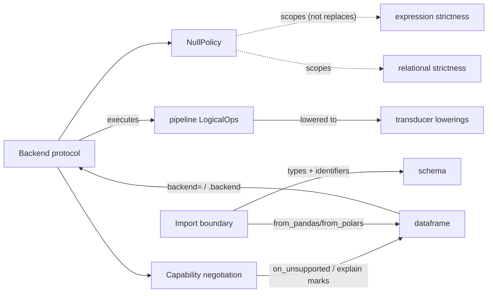

# Meso — `backend` capability

## Cartography — backend (spec district)
**Entry zoom level:** meso (parent: macro map, T2 tier)
**Scope covered:** `openspec/changes/add-backend-adapter-protocol/specs/backend/spec.md` (new capability; its pipeline/dataframe deltas belong to those districts)
**Size:** 4 requirements · 8 scenarios · 145 lines · defined by `add-backend-adapter-protocol`; never modified

## Parent context

The adapter seam promised by the README but never specified — defined here
without shipping any adapter (per the non-goals). Fan-in 7, the corpus'
highest, though most citations come from the change's own delta files; the
load-bearing external edge is `pipeline → backend` (LogicalOp execution).

## Component table

| Component | Path | Role | External ports |
| :--- | :--- | :--- | :--- |
| Backend protocol | `backend/spec.md:3` | `plan(logical_ops) -> rows`; `supports(op)`; `null_policy`; pure-Python backend is default and lowering-preserving | `pipeline` LogicalOp chain; `transducer` lowerings |
| NullPolicy is a backend-level setting | `backend/spec.md` (req 2) | `RAISE` (default, preserves core behavior; scopes existing strictness reqs) / `PROPAGATE` (native semantics, opted-in); no other error class may be relaxed via `null_policy` | scopes `expression`/`relational` strictness |
| Capability negotiation + explicit fallback | `backend/spec.md` (req 3) | `supports(op)`; raise vs opt-in fallback; `explain()` marks `[fallback: python]`; never silent; provenance metadata never affects `supports` | `dataframe` `on_unsupported`, `pipeline` explain |
| Import boundary | `backend/spec.md` (req 4) | `from_pandas`/`from_polars`: unsupported dtype or non-identifier column → `SchemaError` unless `column_map` | `schema` supported types + name constraints |

## Wiring graph

## Structural observations

- Default-path invariance is the capability's backbone: three separate
  requirements state that omitting `backend=` yields behavior identical to
  `add-core-architecture` — the adapter layer is provably additive.
- The NullPolicy scoping paragraph (added in review) is the mechanism that
  prevents `PROPAGATE` from contradicting the unconditional
  `NullValueError` requirements — the corpus' only explicit
  "scopes-not-replaces" clause.
- The pipeline-side delta restructures `DataOp` into `LogicalOp` + lowering;
  the backend itself never touches transducers except as *the* pure-Python
  lowering — a one-way execution dependency.
