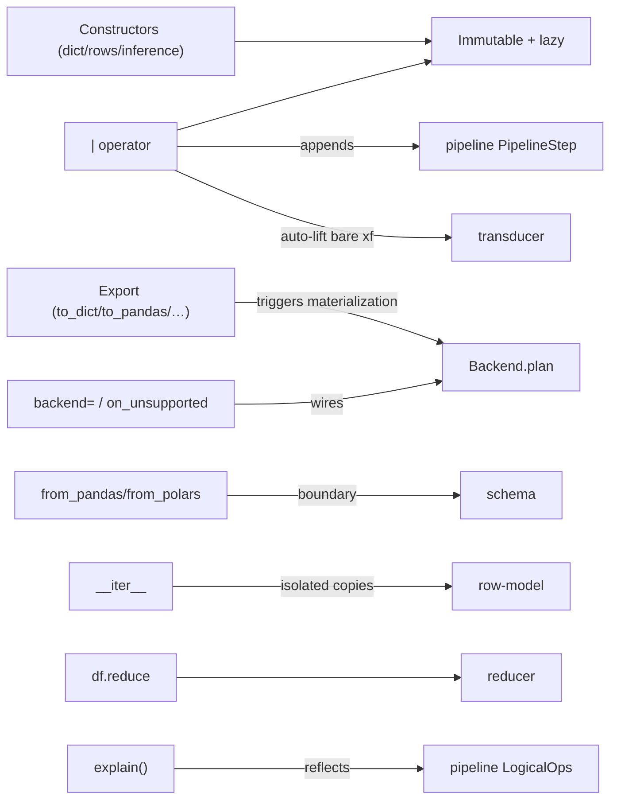

# Meso — `dataframe` capability

## Cartography — dataframe (spec district)
**Entry zoom level:** meso (parent: macro map, T3 user surface)
**Scope covered:** `openspec/changes/add-core-architecture/specs/dataframe/spec.md` + `fix-core-architecture-spec-errors/specs/dataframe/spec.md` + `add-backend-adapter-protocol/specs/dataframe/spec.md`
**Size:** 22 requirements · 68 scenarios · 682 base lines (+136 delta lines) — largest capability by scenarios; modified by fix and backend changes

## Parent context

The user-facing value object: immutable, lazy, endomorphic under `|`.
Everything the user touches directly lives here; everything else exists to
make this file's promises keepable.

## Component table

| Component | Path | Role | External ports |
| :--- | :--- | :--- | :--- |
| Construction from dict / rows / empty (reqs 1–3) | `dataframe/spec.md:3,22,?` | Entry constructors; schema given or inferred | `schema` inference |
| Iteration and length | `dataframe/spec.md:81` | `__iter__`/`__len__`; rows are isolated copies | `row-model` copy isolation |
| Display / HTML display / display shows plan+data | `dataframe/spec.md` (reqs 5,6,14) | REPL and notebook surfaces | — |
| No Series type | `dataframe/spec.md` (req 7) | Column access returns Expr-oriented API, not a Series class | — |
| Helpful error messages | `dataframe/spec.md` (req 8) | UX error standards; `df.head(n)` hint | `errors` message quality |
| Column names / schema property / generic typing | `dataframe/spec.md` (reqs 9,16,17) | Column + type-level API | `schema` |
| Plan inspection without materialization | `dataframe/spec.md:200` | `explain()` (core version — see pipeline district defect note) | — |
| Export to Python structures (modified) | `add-backend-adapter-protocol/specs/dataframe/spec.md:3` | `to_dict`/`to_rows`; adds `to_pandas`/`to_polars` (`UnsupportedOperationError` if missing) | materialization trigger |
| Pipe operator extends plan | `dataframe/spec.md:267` | `df \| step` endomorphism; bare transducer auto-lift; invalid operand → `TypeError` | `pipeline` steps |
| Immutable and always lazy | `dataframe/spec.md:294` | No observable mutation; explicit materialization triggers | the district's constitution |
| head as take shorthand | `dataframe/spec.md:337` | `df.head(n)` = `taking(n)` step | `transducer` |
| User-facing reduce | `dataframe/spec.md:386` | `df.reduce(reducer)` | `reducer`/`aggregation` |
| Auto-schemas after schema-changing steps | `dataframe/spec.md` (req 19) | Post-derive/post-select schema updates | `pipeline` SchemaTransforms |
| Expr-type validation at construction (modified) | `fix-.../specs/dataframe/spec.md:3` | Renumbered to `[HUM-009 / FAIL-008]`; factories reject non-`Expr` | `pipeline` factories, `errors` |
| Construction accepts optional backend (added) | `add-backend-adapter-protocol/specs/dataframe/spec.md:67` | `backend=`, `on_unsupported=`, `.backend` — composition root | `backend` protocol |
| from_pandas/from_polars (added) | `add-backend-adapter-protocol/specs/dataframe/spec.md:91` | Import constructors applying the import boundary | `backend` import boundary |

## Wiring graph

## Structural observations

- Composition root: the only capability that wires the backend protocol
  into user-facing construction — `backend=`/`on_unsupported=`/`.backend`
  all land here.
- Endomorphism (`df | step -> DataFrame`) is specified in three places
  (pipe operator, groupby scenario, immutable/lazy req) and holds — with
  the single documented exception that bare `groupby` returns `Fibers`
  (specified in relational/provenance, not here).
- The misplaced "Plan inspection without materialization" requirement was
  re-homed here during mapping: backend's delta now MODIFIES this file's
  `explain()` requirement directly (LogicalOp chain, backend name,
  `NullPolicy`, fallback marks) instead of duplicating it in `pipeline` —
  the only cross-capability name collision in the corpus, now resolved.
- Largest scenario count (68); also the only capability a *typo fix*
  touches (the `[HUM-009 / FAIL-008]` renumbering).
