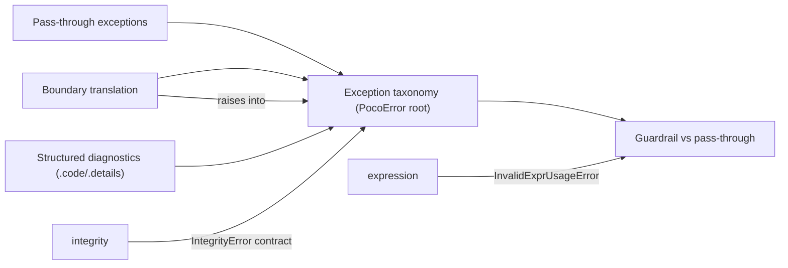

# Meso — `errors` capability

## Cartography — errors (spec district)
**Entry zoom level:** meso (parent: macro map, T1 tier)
**Scope covered:** `openspec/changes/add-core-architecture/specs/errors/spec.md` + `fix-core-architecture-spec-errors/specs/errors/spec.md`
**Size:** 8 requirements · 13 scenarios · 187 lines · defined by `add-core-architecture`; modified by the fix change (taxonomy + new guardrail requirement)

## Parent context

The exception constitution: one taxonomy every other capability raises
into. Fan-in 3 (expression, integrity) plus implicit use everywhere. The
fix change exists substantially to close a hole in this capability's
catch-all promise.

## Component table

| Component | Path | Role | External ports |
| :--- | :--- | :--- | :--- |
| Public exception taxonomy (modified) | `fix-core-architecture-spec-errors/specs/errors/spec.md:3` (replaces `errors/spec.md:3`) | Stable classes rooted at `PocoError`; adds `InvalidExprUsageError(PocoError, TypeError)` | catch-all promise binds expression guardrails |
| Structured exception diagnostics | `errors/spec.md` (req 2) | `.code`, `.message`, `.details` machine-readable fields | consumed by integrity context req |
| Exception message quality | `errors/spec.md` (req 3) | Message content standards | — |
| Public boundary exception translation | `errors/spec.md:86` | Internal `KeyError`/`IndexError` → public classes at API boundary | protects dataframe, pipeline public APIs |
| Documented pass-through exceptions | `errors/spec.md:106` | Raw Python exceptions from user arithmetic propagate unchanged | binds `expression` (`ZeroDivisionError`) |
| Cause chaining and provenance | `errors/spec.md` (req 6) | `__cause__` preservation rules | — |
| Error scenarios remain specification-backed | `errors/spec.md` (req 7) | Every error scenario traces to a spec | meta-requirement |
| Guardrail vs pass-through distinction (added) | `fix-.../specs/errors/spec.md` (ADDED) | poco-raised protocol guardrails subclass native type + `PocoError`; pass-throughs stay raw | implemented by `expression` `__bool__`/`__hash__` |

## Wiring graph

## Structural observations

- The taxonomy is the corpus' error funnel: `integrity`'s `IntegrityError`
  context fields (`.details`) are an instantiation of this capability's
  diagnostics requirement — a clean two-layer design.
- The fix change's addition (`InvalidExprUsageError`) is the only place
  where a dual-inheritance exception (`PocoError` + `TypeError`) exists;
  the design rationale (protocol compatibility vs taxonomy completeness)
  lives in `fix-core-architecture-spec-errors/design.md`.
- `explain()` is *not* part of this capability — no error-related dangling
  references remain after the fix change.
