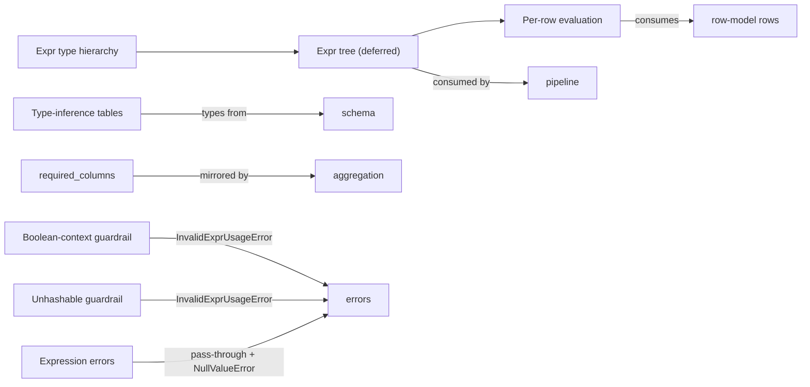

# Meso — `expression` capability

## Cartography — expression (spec district)
**Entry zoom level:** meso (parent: macro map, T1 tier)
**Scope covered:** `openspec/changes/add-core-architecture/specs/expression/spec.md` + `fix-core-architecture-spec-errors/specs/expression/spec.md`
**Size:** 14 requirements · 51 scenarios · 483 lines · defined by `add-core-architecture`; 4 requirements modified by the fix change

## Parent context

The deferred-query language: `Expr` trees built from schema descriptors,
evaluated per-row against the `row-model` contract. Fan-in 5 — every
pipeline factory, aggregation, and integrity step consumes expressions.
Second-largest scenario count (51) after pipeline/dataframe.

## Component table

| Component | Path | Role | External ports |
| :--- | :--- | :--- | :--- |
| Expr type hierarchy | `expression/spec.md:3` | `ColumnRef` / `Literal` / `BinOp` sealed-ish hierarchy | — |
| Expression tree for deferred computation | `expression/spec.md:20` | Operators build trees, never evaluate eagerly | consumed by pipeline factories |
| `Expr.__eq__` returns Expr; explicit unhashable (modified) | `fix-.../specs/expression/spec.md:3` | `__hash__` raises `InvalidExprUsageError` via explicit method (not `__hash__ = None`); `.equals()` for structural comparison | `errors` taxonomy |
| Expression evaluation against a row | `expression/spec.md:117` | Tree evaluated against `dict` row | `row-model` contract |
| Expression errors | `expression/spec.md:134` | `NullValueError` on strict null ops; pass-through of raw arithmetic errors | `errors` (both categories) |
| Null-handling expression methods | `expression/spec.md:164` | `is_null()`, `fill_null()` semantics | — |
| Expression required_columns | `expression/spec.md:217` | Columns referenced, for validation | mirrored by `aggregation` req 2 |
| Expression result type inference | `expression/spec.md:247` | Per-operator result types; `SchemaError` at construction | `schema` types |
| Boolean-context guardrail (modified) | `fix-.../specs/expression/spec.md` | `__bool__` raises `InvalidExprUsageError` with guidance message | `errors` taxonomy |
| Unhashable-Expr guidance (modified) | `fix-.../specs/expression/spec.md` | Message text: "Expr is unhashable. Use column name strings…" | `errors` taxonomy |
| Boolean operators do not short-circuit | `expression/spec.md:344` | `&`/`\|` evaluate both sides | — |
| NaN behavior | `expression/spec.md:369` | NaN comparisons / `is_null()` interplay | — |
| Type-inference decision table (modified) | `fix-.../specs/expression/spec.md` | Arithmetic/comparison tables; floor division unsupported | `schema` types |
| `fill_null` per-expression in binary ops | `expression/spec.md:464` | Null coalescing scope | — |

## Wiring graph

## Structural observations

- The fix change concentrates here: 4 of its 8 requirement deltas modify
  this file — the operator-table typo, both guardrails, and the type-table
  clarification. `expression` is the most fix-dense capability.
- Two guardrail requirements (`__bool__`, `__hash__`) are the only raise
  sites of `InvalidExprUsageError`; the guardrail/pass-through boundary
  (expression errors req) keeps user arithmetic exceptions raw.
- `required_columns` is specified twice — here and mirrored in
  `aggregation` — an intentional echo rather than a citation.
