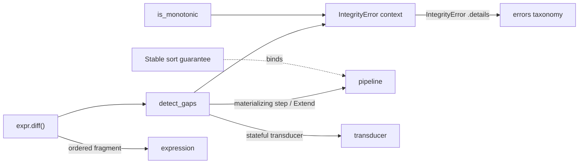

# Meso — `integrity` capability

## Cartography — integrity (spec district)
**Entry zoom level:** meso (parent: macro map, T2 tier)
**Scope covered:** `openspec/changes/add-advanced-data-integrity/specs/integrity/spec.md` (new capability; the change's reducer/relational/transducer deltas belong to those districts)
**Size:** 6 requirements · 13 scenarios · 144 lines · defined by `add-advanced-data-integrity`; never modified

## Parent context

Time-series data-quality operators: gap detection, monotonicity, ordered
diffs. Built entirely on existing machinery — every operator is a
materializing `PipelineStep` with a stateful transducer inside. Fan-in 0
(cited by no other capability), the second orphan after `aggregation` — but
unlike aggregation, it is a leaf consumer by design.

## Component table

| Component | Path | Role | External ports |
| :--- | :--- | :--- | :--- |
| Time-series gap detection | `integrity/spec.md:3` | `po.integrity.detect_gaps(expr, threshold)` — materializing step, adds `is_gap` via `Extend` | `pipeline` (Extend transform), `transducer` (stateful) |
| Monotonicity check | `integrity/spec.md` (req 2) | `is_monotonic(expr, increasing, strict)` — stateful transducer raising on violation | `errors` (IntegrityError contract) |
| Stable sorting | `integrity/spec.md` (req 3) | `po.sort_by` SHALL be stable (Timsort-class) | binds `pipeline` sort_by |
| `diff()` ordered expression fragment | `integrity/spec.md` (req 4) | Current-minus-previous; only valid in ordered materializing steps; `None` on first row / None inputs; non-numeric → `SchemaError`; plain `derive` → `UnsupportedOperationError` | `expression` (fragment), `errors` |
| IntegrityError with pipeline context | `integrity/spec.md` (req 5) | operation / row_index / actual / constraint in `.details` | `errors` structured diagnostics |
| detect_gaps first-row & None handling | `integrity/spec.md` (req 6) | First row = baseline (`is_gap=False`); None-first → `IntegrityError`; later None → `is_gap=True` | — |

## Wiring graph

## Structural observations

- Leaf consumer: adds operators, never gets cited — the cleanest delta in
  the corpus (its other three delta files — reducer, relational, transducer —
  live in those capabilities' districts and compose without name conflicts).
- `diff()` is a cross-capability language extension: an *expression
  fragment* valid only inside integrity steps — the only place one
  capability extends `expression`'s grammar with a context-sensitive rule
  (`UnsupportedOperationError` in plain `derive`).
- Strict sort guarantee (req 3) is specified *here* but governs
  `pipeline`'s `sort_by` — a single binding edge worth watching at
  archival (candidates for relocation into pipeline).
