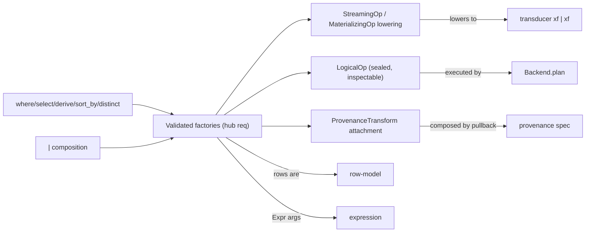

# Meso — `pipeline` capability

## Cartography — pipeline (spec district)
**Entry zoom level:** meso (parent: macro map, T2 orchestration tier)
**Scope covered:** `openspec/changes/add-core-architecture/specs/pipeline/spec.md` + `add-backend-adapter-protocol/specs/pipeline/spec.md` + `add-provenance-tracking/specs/pipeline/spec.md`
**Size:** 13 requirements · 66 scenarios · 681 base lines (+222 delta lines) · modified by backend and provenance changes

## Parent context

The plan layer: factories build `PipelineStep`s; `|` composes them;
materialization lowers them. Jointly owned by three changes — the
factory requirement has been rewritten twice (backend: `LogicalOp`
reification; provenance: `ProvenanceTransform` third component), with
provenance's delta rebased onto backend's text.

## Component table

| Component | Path | Role | External ports |
| :--- | :--- | :--- | :--- |
| Pipeline reusability across DataFrames | `pipeline/spec.md:3` | Steps are reusable values; fresh transducer state per materialization | `transducer` fresh-closure req |
| Schema mismatch on pipe raises early | `pipeline/spec.md` (req 2) | Construction-time validation | `schema` |
| Step composition validates schema compatibility | `pipeline/spec.md` (req 3) | `|` type-checks adjacent transforms | — |
| High-level constructors (Expr-based) | `pipeline/spec.md` (req 4) | Factory signatures over `Expr` | `expression` |
| Cross-layer composition | `pipeline/spec.md` (req 5) | Streaming/materializing/lifting interplay | — |
| `where` builds filtering step | `pipeline/spec.md:145` | Streaming filter factory | `transducer` `filtering` |
| **Validated factories (modified ×2 — the hub req)** | `add-provenance-tracking/specs/pipeline/spec.md:10` (current text) | No public constructor; `DataOp` carries `LogicalOp` + pure-Python lowering; every factory attaches `ProvenanceTransform`; composition = LogicalOp concat + provenance pullback | `backend` (LogicalOp), `provenance` (transform) |
| SchemaTransform exhaustiveness | `pipeline/spec.md:204` | Sealed handling discipline for transforms | pattern for provenance exhaustiveness |
| `comp` left-to-right with named params | `pipeline/spec.md` (req 10) | Step composition combinator | — |
| `sort_by` / `derive` / `distinct` factories | `pipeline/spec.md` (reqs 11–13) | Materializing sort; computed columns; dedup step | `transducer` (distinct → PipelineStep) |

## Wiring graph

## Structural observations

- The hub requirement ("PipelineStep SHALL only be constructed through
  validated factories") carries the merged weight of three changes: base
  factories contract + backend's `LogicalOp` + provenance's third component.
  Any future change touching `PipelineStep` shape must rebase on it again.
- Highest scenario count in the corpus (66) with `dataframe` (68) — the two
  user-facing surfaces.
- A mapping-time defect was found and fixed: backend's delta declared
  "Plan inspection without materialization" (an `explain()` requirement)
  here, but that requirement lives in `dataframe`. It has been moved to the
  backend change's dataframe delta as a proper `MODIFIED` — pipeline is now
  a pure plan/step capability.
- `distinct`'s factory lives here but its machinery lives in `transducer` —
  the return-type contradiction the fix change resolved was exactly this
  seam.
