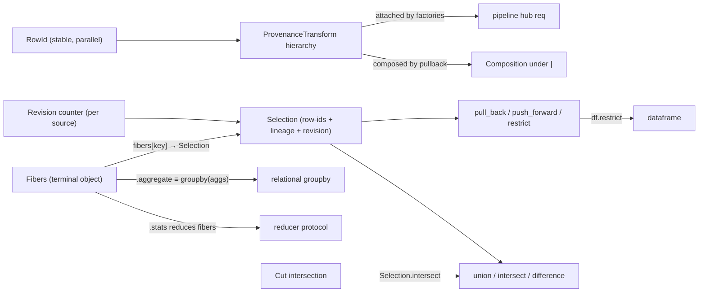

# Meso — `provenance` capability

## Cartography — provenance (spec district)
**Entry zoom level:** meso (parent: macro map, T2 tier)
**Scope covered:** `openspec/changes/add-provenance-tracking/specs/provenance/spec.md`
**Size:** 10 requirements · 31 scenarios · 420 lines · defined by `add-provenance-tracking` (new capability); the corpus' fan-out hub (11 outgoing edges)

## Parent context

Row identity and traceability: every output row can answer "which source
rows produced you." Applied *after* `add-backend-adapter-protocol`; its
pipeline delta is rebased onto the post-`LogicalOp` factory requirement.
This district was fully redesigned this session (unconditional retention,
no `keep_fibers` flag) and passed a 5-pass specification review.

## Component table

| Component | Path | Role | External ports |
| :--- | :--- | :--- | :--- |
| RowId stability + determinism scope | `provenance/spec.md:3` | Stable per-row identity held parallel to row dict; non-deterministic steps (e.g. `distinct(ttl)`) → `ValueError` on provenance materialization | `row-model` (parallel, not inside); `transducer` TTL |
| RowId not in exported structures | `provenance/spec.md` (req 2) | Exports stay exactly-schema; access only via provenance APIs | `row-model`, `dataframe` exports |
| ProvenanceTransform sealed hierarchy | `provenance/spec.md` (req 3) | `Bijection`/`Injection`/`Fibration`/`Span`; forward + reverse maps (O(1) lookup); exhaustiveness discipline | `pipeline` factories attach; mirrors `SchemaTransform` |
| Composition by pullback under `\|` | `provenance/spec.md` (req 4) | Composed spans = pullback of constituents; inspectable pre-materialization | `pipeline` `\|` composition |
| Selection: pull_back / push_forward / restrict | `provenance/spec.md:130` | Core algebra + `df.select_rows(pred)` direct construction (materializes plan) | `dataframe`, `expression` (pred) |
| Sub-statistics over a fiber | `provenance/spec.md` (req 6) | `df.restrict(fibers[key])` = fiber rows; `.stats(key_or_selection, **kw) -> dict`; `.aggregate` reduces all fibers | `reducer` (any reducer), `relational` (aggregate equivalence) |
| `Fibers` first-class object | `provenance/spec.md:246` | `.keys` (first-appearance), `fibers[key]` → `Selection`, terminal for `\|`, public signatures block | `relational` groupby |
| Selection set algebra | `provenance/spec.md` (req 8) | `union`/`intersect`/`difference`; cross-source → `ValueError` | — |
| Fibration cuts intersect, never cross-product | `provenance/spec.md` (req 9) | Multi-view cuts via `Selection.intersect`; no joint key-space structure | — |
| Revision-stamped selections | `provenance/spec.md` (req 10) | Per-source monotonic counter; every producing op assigns next; consumers discard non-increasing | — |

## Wiring graph

## Structural observations

- Densest capability by connectivity: 11 outgoing edges across 5 other
  capabilities; also the only one whose pipeline delta rebases onto another
  pending change's text (documented ordering: backend first, provenance
  second).
- Three interface seams co-owned with other capabilities: `groupby`
  (relational), `unstep` (reducer), factory attachment (pipeline) — each
  seam was rewritten this session to remove a flag, a contradiction, or a
  phantom API.
- Determinism scoping is the newest seam: RowId stability explicitly
  excludes TTL-dependent pipelines, closing the integrity↔provenance
  contradiction before it could ship in a spec.
- 31 scenarios cover happy paths, negative paths (cross-source, unknown
  key, empty fiber + partial reducer), and concurrency-adjacent ordering
  (revision) — the highest negative-path density in the corpus.
