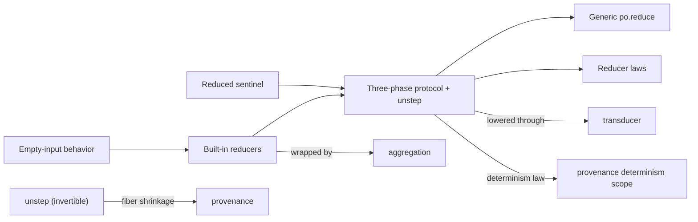

# Meso — `reducer` capability

## Cartography — reducer (spec district)
**Entry zoom level:** meso (parent: macro map, T1 tier)
**Scope covered:** `openspec/changes/add-core-architecture/specs/reducer/spec.md` + `add-advanced-data-integrity/specs/reducer/spec.md` + `add-provenance-tracking/specs/reducer/spec.md`
**Size:** 9 requirements · 19 scenarios · 184 base lines (+128 delta lines) · modified by integrity and provenance changes

## Parent context

The reduction algebra: `init/step/complete` (+ optional `unstep`), the
`Reduced` sentinel, the determinism law. Every aggregate in the system —
`aggregate`, `.stats`, `po.reduce`, transducer lowering — is this protocol.

## Component table

| Component | Path | Role | External ports |
| :--- | :--- | :--- | :--- |
| Three-phase reducer protocol (modified ×2) | `add-provenance-tracking/specs/reducer/spec.md:3` (current text) | `init/step/complete` + optional `unstep(acc, item)`; pre/postconditions; invertibility invariant `unstep(step(acc,item),item) == acc` | `provenance` fiber shrinkage; `transducer` wrapping |
| Generic reduce drives the protocol | `reducer/spec.md:29` | `po.reduce(reducer, collection)` driver; exactly-once `complete()` | — |
| Reducer laws | `reducer/spec.md` (req 3) | Associativity-style laws for built-ins | — |
| `Reduced` sentinel | `reducer/spec.md` (req 4) | Early termination; flattening | consumed by `transducer` `taking` |
| Built-in reducers (modified) | `add-advanced-data-integrity/specs/reducer/spec.md:3` | `to_list`, `count`, `sum_reducer`, `min_reducer`, `max_reducer`, `mean` | wrapped by `aggregation` factories |
| Protocol state machine and violations | `reducer/spec.md` (req 6) | Illegal phase sequences → errors | — |
| Built-in empty-input behavior | `reducer/spec.md` (req 7) | total (`count`) vs partial (`mean`, `min`) on empty | inherited by `aggregation` req 4 |
| Neumaier compensated summation (modified) | `add-advanced-data-integrity/specs/reducer/spec.md:21` | `sum_reducer` accuracy bound | — |
| sum/inf/NaN propagation (modified) | `add-advanced-data-integrity/specs/reducer/spec.md:40` | IEEE 754 semantics | — |

## Wiring graph

## Structural observations

- Two changes modify the *same* requirement ("Three-phase reducer protocol")
  from two directions: integrity adds summation correctness requirements as
  separate reqs; provenance rewrites the protocol itself to add `unstep`.
  No name collision — integrity's three reqs are new names — so the deltas
  compose cleanly (verified against both delta files).
- The determinism law ("complete called exactly once"; deterministic
  results) is the anchor that provenance's non-determinism scoping and
  transducer's TTL exemption both point at — a three-way contract with
  `reducer` as the hub.
- `unstep` has a property-based-test mandate (`unstep(step(acc,item),item)
  == acc`) — one of two PBT mandates in the corpus (the other: transducer
  state independence).
