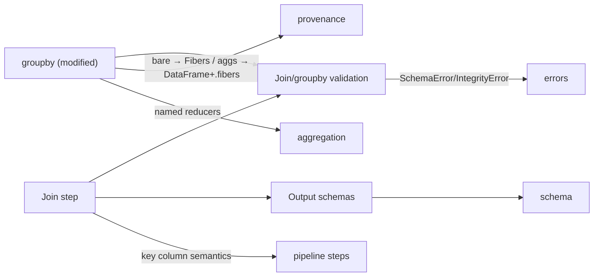

# Meso — `relational` capability

## Cartography — relational (spec district)
**Entry zoom level:** meso (parent: macro map, T2 tier)
**Scope covered:** `openspec/changes/add-core-architecture/specs/relational/spec.md` + `add-advanced-data-integrity/specs/relational/spec.md` + `add-provenance-tracking/specs/relational/spec.md`
**Size:** 18 requirements · 44 scenarios · 441 base lines (+148 delta lines) · modified by integrity and provenance changes

## Parent context

The relational algebra surface: joins and groupby as `PipelineStep`s. The
traceability-tagged district (BIZ/MATH/ARCH tags live here), and the
capability that motivated provenance — groupby's collapse was the gap.

## Component table

| Component | Path | Role | External ports |
| :--- | :--- | :--- | :--- |
| Join as relational DataFrame operation | `relational/spec.md:3` | `on` expression restricted; lazy join step | — |
| Supported join types (modified) | `add-advanced-data-integrity/specs/relational/spec.md:3` | inner/left/right/outer semantics | — |
| Relational output schemas | `relational/spec.md` (req 3) | Join result schemas | `schema` |
| Join collision handling / nullable-side promotion | `relational/spec.md` (req 4) | Suffix rules, Optional promotion | — |
| Multi-column equi-joins | `relational/spec.md` (req 5) | Tuple keys | — |
| **Groupby as relational pipeline step (modified)** | `add-provenance-tracking/specs/relational/spec.md:3` (current text) | Bare `groupby` → `Fibers`; aggregating form → collapsed `DataFrame` exposing `.fibers`; no `keep_fibers` flag; retention unconditional | `provenance` (Fibers/Fibration), `aggregation` (reducers) |
| Join and groupby validation | `relational/spec.md` (req 7) | Pipe-time column checks → `SchemaError` | — |
| Deterministic join output order | `relational/spec.md` (req 8) | Order guarantee | — |
| Null-semantics divergence groupby vs join `[BIZ-002]` | `relational/spec.md` | Documented intentional difference | — |
| Self-join positional on-parsing `[BIZ-003]` | `relational/spec.md` | on-expression form | — |
| groupby keys / derive requirement `[BIZ-004]` | `relational/spec.md` | Computed keys need `po.derive` | `pipeline` derive |
| Join key left-name / right drop `[BIZ-005]` | `relational/spec.md` | Key naming rule | — |
| Join output column order `[MATH-009]` | `relational/spec.md` | Deterministic order | — |
| All-None group is single group `[MATH-010]` | `relational/spec.md` | Null grouping equality | — |
| Join suffixes only on colliding non-key columns `[MATH-013]` | `relational/spec.md` | Suffix scope | — |
| `SchemaError` if suffixes unresolved `[ARCH-010]` | `relational/spec.md` | Collision failure mode | `errors` |
| IntegrityError from join validate `[BIZ-012]` (modified) | `add-advanced-data-integrity/specs/relational/spec.md:38` (current) | Diagnostic context in join validation | `errors`, `integrity` |
| Join validate IntegrityError context (modified) | `add-advanced-data-integrity/specs/relational/spec.md:38` | `.details` fields | `errors` diagnostics |

## Wiring graph

## Structural observations

- The provenance redesign landed here hardest: the old "at least one
  aggregation kwarg" and "keep_fibers mutual exclusivity" `ValueError`
  requirements were replaced by the two-form contract; retention is now
  unconditional.
- This district carries nearly all explicit traceability tags (BIZ-00x,
  MATH-00x, ARCH-010, BIZ-012) — the rest of the corpus is untagged.
- Co-ownership with `provenance` is structural: `groupby` is specified in
  this file's requirement but its result types (`Fibers`, `.fibers`) are
  defined in `provenance` — the reference cycle flagged in the macro map.
