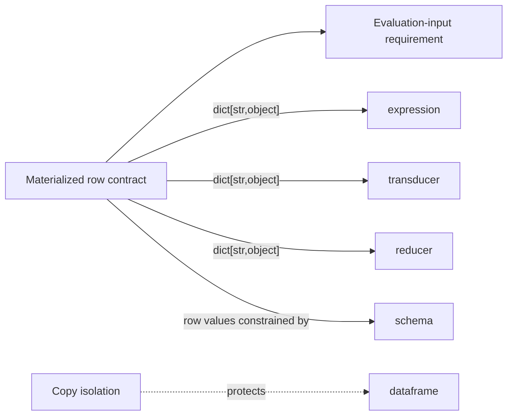

# Meso — `row-model` capability

## Cartography — row-model (spec district)
**Entry zoom level:** meso (parent: macro map, T0 foundation tier)
**Scope covered:** `openspec/changes/add-core-architecture/specs/row-model/spec.md`
**Size:** 3 requirements · 5 scenarios · 50 lines · defined by `add-core-architecture`; never modified by any delta

## Parent context

The single most-depended-upon *contract* in the system (fan-in 4 via
requirement citations from expression, transducer, provenance). It defines
what a "row" is everywhere else; it has no behavior of its own.

## Component table

| Component | Path | Role | Talks to (internal) | External ports |
| :--- | :--- | :--- | :--- | :--- |
| Materialized row contract | `add-core-architecture/specs/row-model/spec.md:3` | Row = `dict[str, object]`, insertion-ordered per schema field order; explicit ergonomics-over-performance trade-off note | defines the input type for both evaluation components below | consumed by `expression`, `transducer`, `reducer`, `dataframe` iteration |
| Row copies are isolated from DataFrame storage | `row-model/spec.md` (req 2) | Yielded rows are independent dict copies; mutation cannot leak into storage | — | protects `dataframe` immutability guarantee |
| Row contract is the evaluation input | `row-model/spec.md:37` | All expression evaluation and row-oriented reducer/transducer processing MUST accept this contract | binds req 1 to consumers | `expression` evaluation, `po.reduce` |

## Wiring graph

## Structural observations

- Only 3 requirements, zero fan-out to code-like capabilities — pure
  contract node; changing it invalidates every consumer at once (highest
  blast radius per line in the corpus).
- The ergonomics-over-performance note (req 1) is the corpus' only explicit
  non-functional trade-off statement.
- `provenance` holds `RowId` "alongside, not inside" this contract by
  explicit design (provenance req 1) — the two contracts were co-designed
  to avoid modifying this file.
