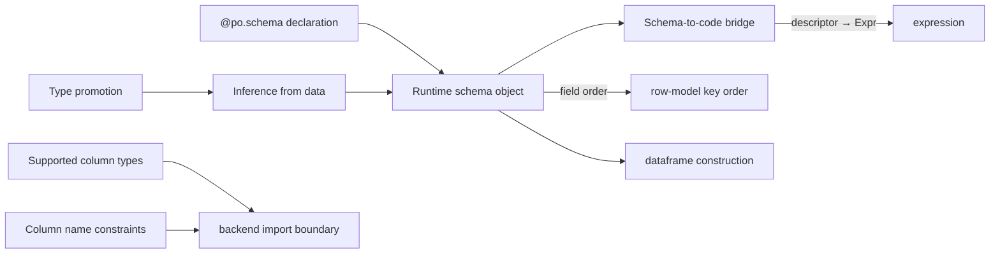

# Meso — `schema` capability

## Cartography — schema (spec district)
**Entry zoom level:** meso (parent: macro map, T0 foundation tier)
**Scope covered:** `openspec/changes/add-core-architecture/specs/schema/spec.md`
**Size:** 11 requirements · 37 scenarios · 298 lines · defined by `add-core-architecture`; never modified by any delta

## Parent context

T0 tier next to `row-model`. Declares *what columns exist and what types
they hold*; everything downstream (expression type inference, dataframe
construction, backend import boundary) leans on it. Fan-in 3.

## Component table

| Component | Path | Role | External ports |
| :--- | :--- | :--- | :--- |
| Schema declaration via `@po.schema` | `schema/spec.md:3` | Class-decorator schema authoring | Python class syntax → `Schema` |
| Runtime schema object | `schema/spec.md:36` | The `Schema` value: fields, order, types | consumed by dataframe, pipeline |
| Schema inference from data | `schema/spec.md` (req 3) | Infer schema from raw dicts/rows | `from_pandas`/`from_polars` (backend) reuse it |
| Numeric type promotion in inference | `schema/spec.md` (req 4) | int→float promotion rules | — |
| Supported column types | `schema/spec.md:130` | The allowed set: `int \| float \| str \| bool` + Optional | cited by backend import boundary |
| Column name constraints | `schema/spec.md` (req 6) | Valid Python identifiers, no keyword collisions | cited by backend import boundary |
| Schema to code bridge | `schema/spec.md` (req 7) | Schema ↔ generated accessors (descriptor `Person.age` → `Expr`) | feeds `expression` |
| Schema subclassing | `schema/spec.md` (req 8) | Schema evolution via subclass | `SchemaError` on invalid evolution |
| Zero-field schema is valid | `schema/spec.md` (req 9) | Edge-case: empty schema legal | — |
| Field ordering deterministic | `schema/spec.md` (req 10) | Field order stable — row-dict key order depends on it | `row-model` key order |
| Inference rejects incompatible families | `schema/spec.md` (req 11) | Mixed incompatible types → `SchemaError` | — |

## Wiring graph

## Structural observations

- One layer-skip lives here: the supported-types/identifier rules are cited
  directly by `backend`'s import boundary (T0 → T2) — the import boundary
  *is* schema policy applied at the edge.
- `schema → dataframe` is the single T0→T3 edge in the corpus (construction-
  time schema validation); flagged in macro open questions.
- Unmodified by any pending delta — stable bedrock.
