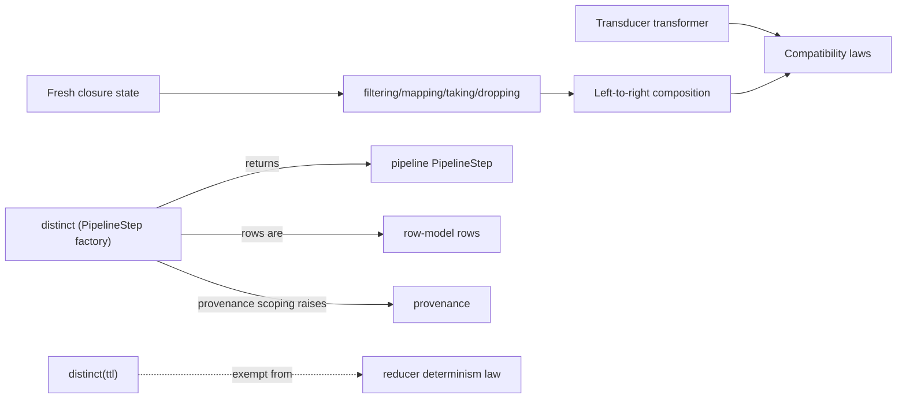

# Meso — `transducer` capability

## Cartography — transducer (spec district)
**Entry zoom level:** meso (parent: macro map, T1 tier)
**Scope covered:** `openspec/changes/add-core-architecture/specs/transducer/spec.md` + `add-advanced-data-integrity/specs/transducer/spec.md` + `fix-core-architecture-spec-errors/specs/transducer/spec.md`
**Size:** 13 requirements · 23 scenarios · 199 base lines (+149 delta lines) · modified by integrity and fix changes

## Parent context

The streaming algebra: reducers transformed by transducers, composed
left-to-right, executed row-at-a-time. This is the *lowering target* of
every `StreamingOp` — pipeline builds the plan, transducers execute it.

## Component table

| Component | Path | Role | External ports |
| :--- | :--- | :--- | :--- |
| Transducer as reducer transformer | `transducer/spec.md:3` | `xf(reducer) -> reducer`; wraps all three phases | `reducer` protocol, `row-model` items |
| Transducer-reducer compatibility laws | `transducer/spec.md` (req 2) | Init/complete/Reduced propagation laws | `reducer` `Reduced` sentinel |
| Composition is left-to-right | `transducer/spec.md:45` | `xf1 \| xf2` data order; associative; internally right-to-left wrapping | — |
| Identity transducer | `transducer/spec.md` (req 4) | Monoid identity of composition; `comp()` with no args | — |
| Core transducers | `transducer/spec.md:87` | `filtering`, `mapping`, `taking`, `dropping` | `Reduced` early termination |
| Fresh closure state per wrapping | `transducer/spec.md` (req 6) | Mutable state per wrapping, never shared | — |
| Factories stateless and reusable | `transducer/spec.md` (req 7) | Transducer values reusable across pipelines | supports `pipeline` reusability req |
| Complete propagation order | `transducer/spec.md` (req 8) | Outermost-first `complete()`; buffer flush | — |
| State independence via property tests | `transducer/spec.md` (req 9) | PBT mandate for taking/dropping/distinct | — |
| Stateful distinct transducer (modified) | `fix-.../specs/transducer/spec.md:3` (replaces integrity's delta) | `po.distinct(...)` returns a **`PipelineStep`** whose data component is the TTL-aware dedup transducer | `pipeline` (authoritative return type) |
| `distinct(ttl)` non-deterministic (modified) | `add-advanced-data-integrity/specs/transducer/spec.md:22` | Wall-clock dependent; excluded from reproducibility | provenance determinism scoping |
| distinct memory growth safeguards (modified) | `add-advanced-data-integrity/specs/transducer/spec.md:40` | `ttl`/`max_seen` eviction (LRU) | — |
| TTL exempt from determinism law (modified) | `add-advanced-data-integrity/specs/transducer/spec.md:68` | TTL transducers carved out of determinism | `reducer` determinism law |

## Wiring graph

## Structural observations

- `distinct` is the corpus' most re-traded contract: specified in integrity,
  *corrected by the fix change* (return type → `PipelineStep`), and scoped
  by provenance (TTL → provenance raises). Three changes, one requirement —
  the clearest case for breaking the cross-change coupling at archival.
- The fix change's transducer delta pins the return-type correction with a
  dedicated scenario (`isinstance(result, Transducer) SHALL be False`).
- `taking(n)` is the only specified early-termination consumer of
  `Reduced` outside `reducer` itself.
